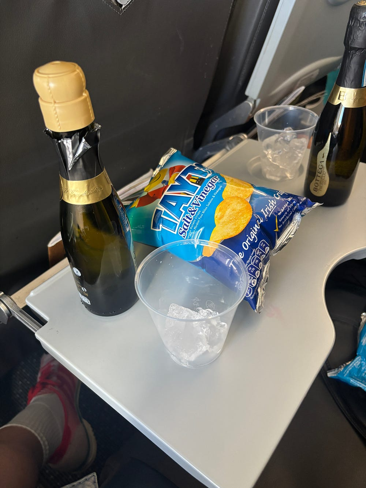

Ireland is a rich country, but presents its wealth in the way that a totalitarian, post-Soviet country, bubbling with oil and newfound capitalist dreams, would showcase a state-of-the-art sports stadium. There isn't really a need for it, and most of your constituents are scraping to get by, but it's important to show that the government could – if they really wanted to – provide for their people.

Stories of a single €332,282 bike shed at Leinster House, a cost just shy of the median house price in Ireland, offer up an eye-rolling, elbow-to-the-ribs insight into how the government decides to operate. Then there was the white-water rafting thing. Or the fact that the Children's Hospital still isn't built. Or the Ryan Tubridy debacle...actually, let's not get into that. Sure, it's grand! We're a cool country now! Everybody loves Fontaines DC and CMAT. Have you heard you can get chicken fillet rolls in London now? Ha-ha!

I am fervently protective of my country, and seethe at the Father Ted-isms or Paddywhackery that accompany how many people – and countries – discuss Ireland. I've lived in Amsterdam for 10 years, and my relationship with Ireland has only strengthened over that time. Absence, and the desperation to leave this 'shithole island' at the ripe age of 18 (my words), really does make the heart grow fonder. But every time I spot an Etsy Claddagh ring in the wild, or somebody asks me if I ever want to move home, I feel a sad, seething rage deep from within. I know it's a *me* problem, but I end up gritting my teeth and smiling to stop myself from flinging that person against the wall and asking them *if they've been to Dublin recently? Have they paid for a cup of coffee? Do they know anybody living there who lives with friends instead of their parents?*

I miss the mountains, the sea swims, the salty air. I miss a decent selection of Greek yoghurt in the supermarket. As much as I roll my eyes at the permeating mysticism of the Irish Conversation, I miss the warmth and the roughness of the land I reviled for so long.

Where am I going with this? I'm not sure. Like a bitter ex who just can't get over it, I just wish it could miss me back.
