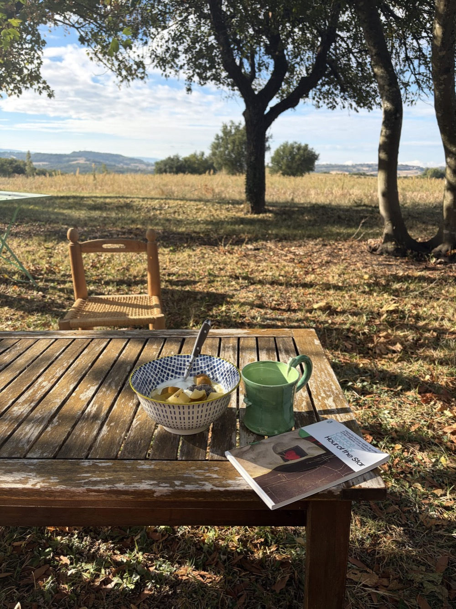

Nearly two weeks ago, the honour was bestowed on me, for a second time in six years, of being let go from my corporate tech job. What started with hushed murmurings around the office, a slightly awkward team outing the night before, and a brief, pained discussion with my manager ended with my laptop being wiped, unceremoniously, four days later. My handover fit snugly into a Google Doc, and I opted out of saying a few words during the all-company Zoom call the following Friday. With the kind promises of glowing references and future coffee dates from a few really lovely colleagues, I left my role as a Senior Writer at a burgeoning tech company with no plan in place.

I hold no resentment towards my former employer, because I feel as if a simple decision was made for me. I’m thankful for that. You don’t often get somebody else to make those choices for you – for months, I had felt that something was off, and I was reading into my interpersonal relationships at work way too much. When I’m unhappy, I feel like everyone hates me, and that led to work I wasn’t particularly proud of or excited about. It’s hard to write a funny Instagram caption when you don’t care about what you’re writing, or chirp up in a meeting about paid ads when you’re over-analysing the dynamics of somebody cancelling a meeting on you ten minutes before it starts. I could have gone on like this for months, slowly chipping away at myself, until I couldn’t bear it any longer. But with a planned restructuring, a definite contract and a tech landscape that’s not-so-silently eating up half the jobs in my industry, I was off to the races.

The landscape spreads out in front of me, vast and untouched. Gardening leave conjures images of a sweet old lady pottering around her allotment, not a twenty-nine-year-old scrolling LinkedIn in sweaty running gear while *Girls* streams in the background. All in good time, I tell myself. I have plenty of it, after all, and I plan to use it wisely. So I’m going to use these next few months to write about it, run, sleep, take photos and maybe even get my portfolio updated. I’ve updated [my website](https://fraeji.com) (check it out 😎), I’m making my way through the Booker Prize longlist and booked a couple of flights. We’ll see what happens after that.

*Sent from my mother’s (somewhat sparse) orchard in the South of France.*

