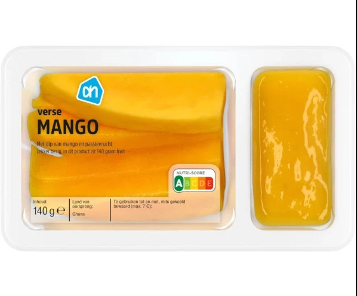

I've always had a penchant for a maximalist superstore experience. A place where you'd get lost in the aisles of produce, sometimes delicious and exquisite, sometimes utter crap, where you could wander around for hours and wouldn't see the same person twice. I would wait with bated breath for my mother's weekly invitation of 'who wants to go to Big Tesco?' with the same seam-bursting excitement as I would on Christmas Eve. We'd pile into the family Volvo, once the homework and bowls of spaghetti bolognese were cleared from the table, and we'd sail off into the early evening, Bags for Life and delirious children in tow. The Volvo doors would open, and we'd spill out into the car park, me the eldest, shepherding my flock (two younger sisters and a Barbie doll or two) through the revolving doors into the Mecca that was Tesco Extra on Knocknagoney Road.

I feel about supermarkets the same way I feel about going to the cinema. You decide that you will, temporarily, step out of this mortal coil and into a place where time stands still. Gone are the outside maladies of work, school or any of that other stressful stuff, because, for a brief moment, you exist only to browse, fantasise, and feed. Heatwave outside? Its chilled interior a calming breath. Stressful day at work? Let your troubles dissipate in the cereal aisle. I'll never get overwhelmed by the fluorescent lighting, the metallic jangling of trolleys or the static of the loudspeaker. Quite the opposite – I relish the discomfort of the endless aisles and gormless teenagers stacking shelves. This little ecosystem hums along as I float, blissfully and aimlessly, through.

I've got favourites. I rank as follows: French, German, Irish, and a UK Marks & Spencers up there too. French for the endless assortment of mayos and local biscuits, German for the bread section and their whirring abattoir of slicing machines, Irish for Dunne's (obviously). My capitalist appetite satiated, every nip-out-to-the-shop-for-milk a treasure hunt for own-brand delights. I go in for a bag of rice, I come out with Tesco's Finest sourdough, a bottle of half-priced Spätburgunder and a lemon balm candle that won't fill my living room with cancerous toxins. I feel delirious on my supermarket quests, knowing that for a modest sum, I can feel pure, unadulterated joy.

But not all supermarkets are created equal. I live in the Netherlands, a country that excels in its engineering and shipbuilding capabilities, with an education system and digital infrastructure that would make a German – or Irish, for that matter – weep. Said infrastructure is something that, if I decide to leave this place, I will miss dearly. Countries can only be very good at some things – with supermarkets not being one of those.

Every time I'm forced to part with my hard-earned cash to buy tasteless, shrink-wrapped bell peppers, or aerated bread that turns stale after an hour, a small part of me dies. Irritated, I wander the confectionery aisle in Albert Heijn in search of a good-quality sweet treat, only to find something as nefarious as a Dubai Chocolate(tm) tompouce on special offer. Mango sticks sitting sadly with a congealed passionfruit dip. A poké bowl-style layer cake wedged into the deli aisle. As I confront these monstrosities, I think of the genius of the M&S food development team, and wonder why I can't have it all in this life.

So when I return home, I always know exactly where I'll go first. The capitalistic joy of a perfectly ripe heirloom tomato that's not pumped full of water welcomes me back like a warm embrace – and I'll eat it up every time.
