The self-confessed disruptor of hotels. citizenM has a distinctive, bold and cheeky tone of voice that is used to inspire, inform and delight. As a creative in the esteemed Brand team, I worked on campaign narratives and created scripts and social concepts.

## Opening citizenM Rome

When launching our first hotel in Rome, we needed a way to introduce a modern hotel in a city steeped in history, appealing to an audience of modern travellers while nodding to the ancient monuments that surround the new location.

My team and I highlighted five local citizens whose performing, cooking, crafting, designing and composing embody the new modern face of Rome. With agencies KesselsKramer and Neighbour London, we sculpted citizens of Rome as digital marble busts and rendered them spinning in 360 degrees, bringing the juxtaposition of old and new worlds to life.

The project culminated in an out-of-home campaign in key Italian cities, a social media campaign and a five-storey building exhibition, which turned the new hotel into a billboard.

## citizenM Rome: Artist Files

I interviewed and directed Rome-based muralist UNO for a sneak peek of his work on the hotel’s façade, bringing his love of Rome and artistic process to the screen.

  <video controls playsinline preload="metadata" aria-label="citizenM Rome: Artist Files featuring muralist UNO">
    <source src="/videos/citizenm/rome-artist-files.mp4" type="video/mp4" />
  </video>

## Citizens of the World: Miami, Seattle, London, Chicago hotel openings

We believe the people make the place. So whenever citizenM opens a new hotel, we shine a light on the citizens who call these cities home. They each embody something that makes the city great: fashion, culture, business, art or party.

With director Leila Fakouri, my team and I created a portrait series that was posted across our social channels, with an accompanying video series on YouTube. I constructed the narrative for each citizen across Meta, YouTube and TikTok, and worked with our videographer to bring the right art direction to life.

  <figure>
    
  </figure>
  <figure>
    <video autoplay loop muted playsinline preload="metadata" aria-label="Animated Seattle citizen portrait">
      <source src="/videos/citizenm/world/seattle.mp4" type="video/mp4" />
    </video>
  </figure>
  <figure>
    
  </figure>
  <figure>
    <video autoplay loop muted playsinline preload="metadata" aria-label="Animated citizen portrait with a mannequin">
      <source src="/videos/citizenm/world/mannequin-kiss.mp4" type="video/mp4" />
    </video>
  </figure>
  <figure>
    
  </figure>
  <figure>
    <video autoplay loop muted playsinline preload="metadata" aria-label="Animated close-up citizen portrait">
      <source src="/videos/citizenm/world/beauty-closeup.mp4" type="video/mp4" />
    </video>
  </figure>

  <video autoplay loop muted playsinline preload="metadata" aria-label="Citizens of the World video">
    <source src="/videos/citizenm/youtube-5zvXDp7Du2Y.mp4" type="video/mp4" />
  </video>

## Social media copy

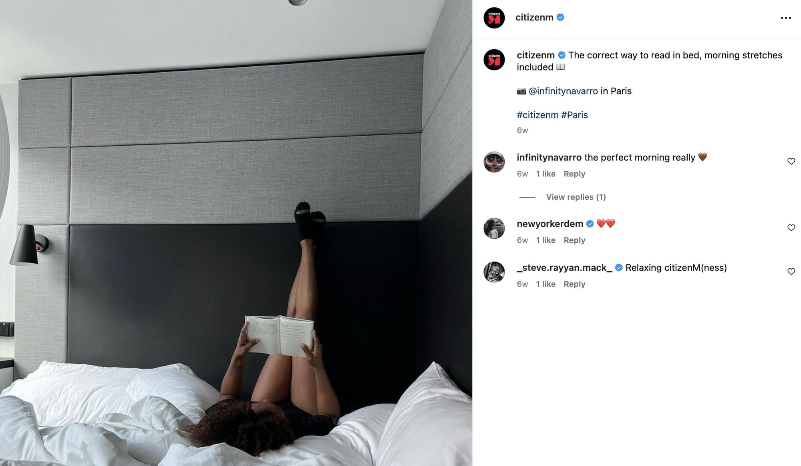
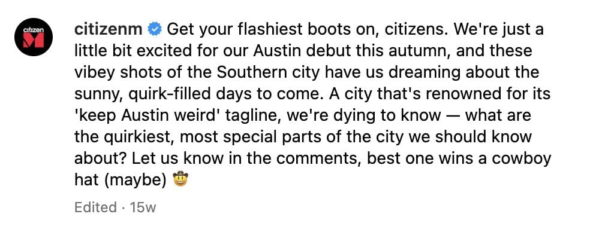
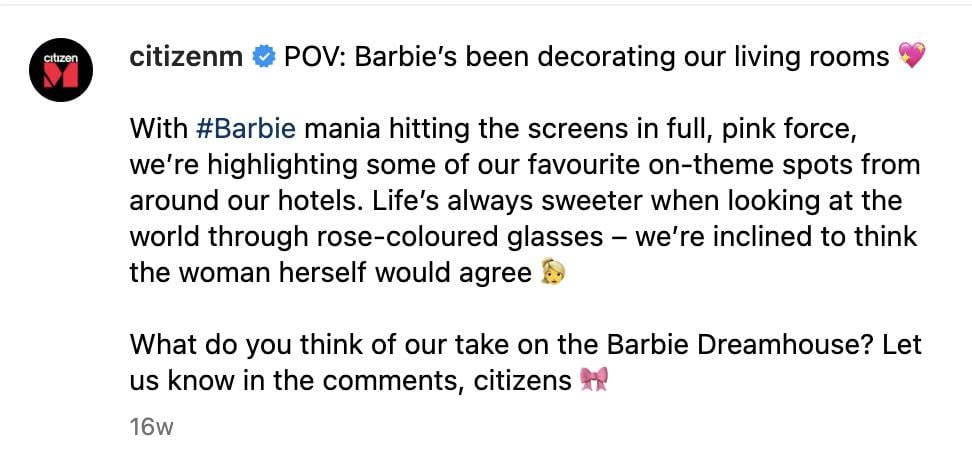
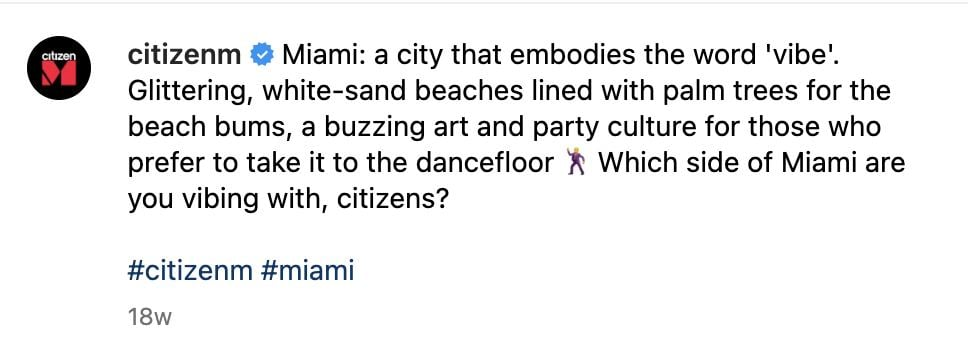
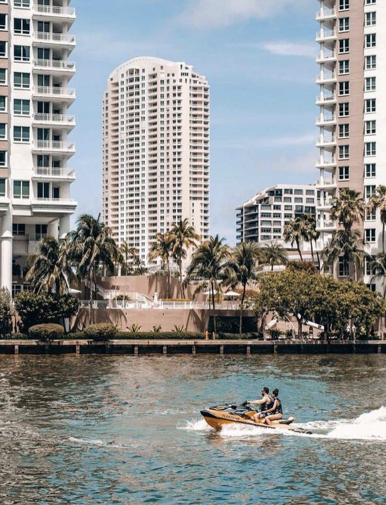
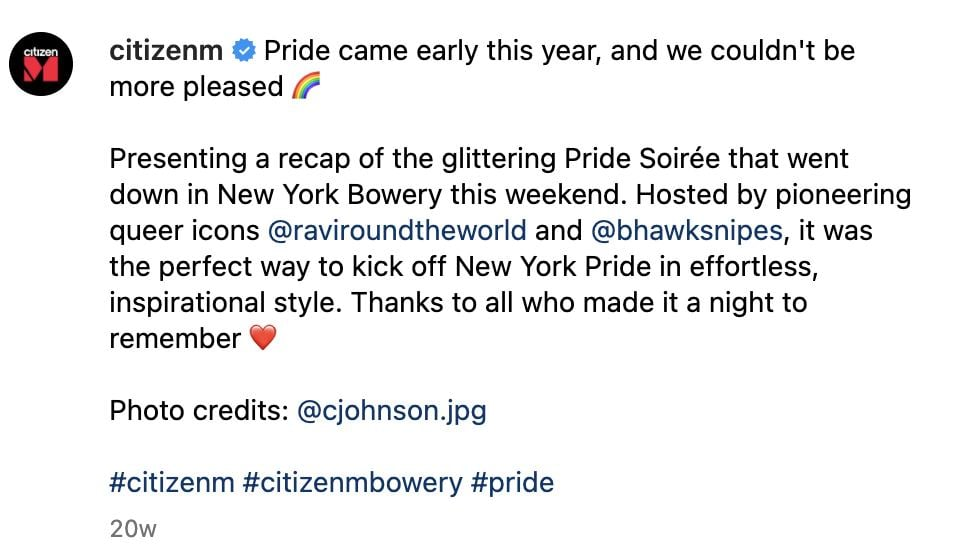
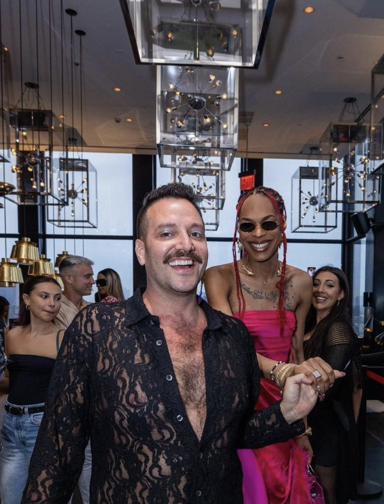
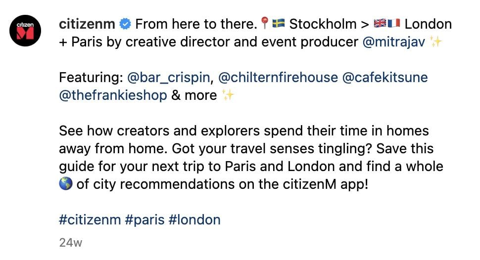
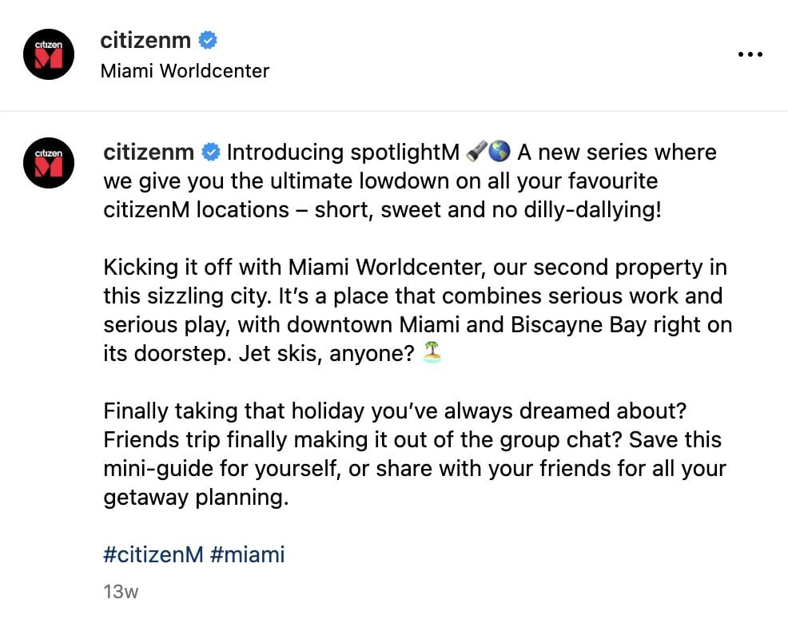
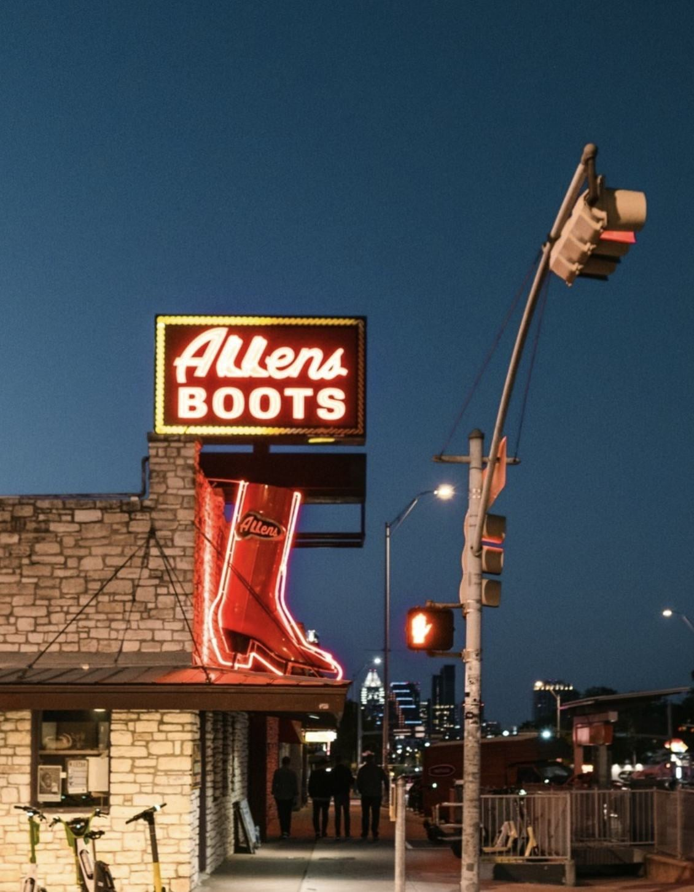

## In-app copy

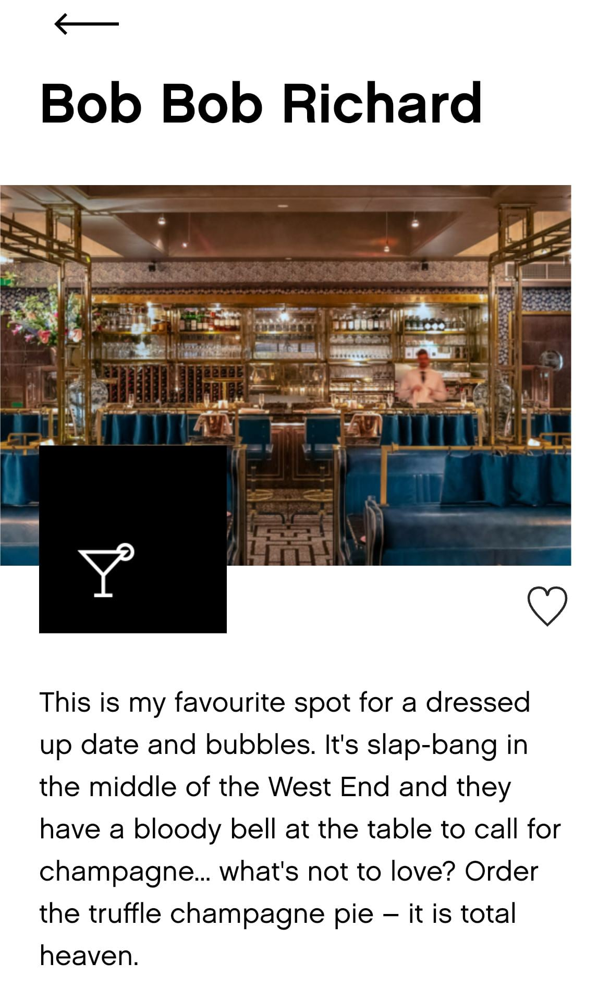
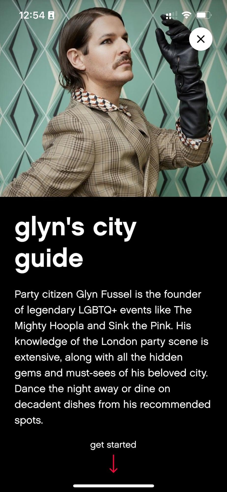
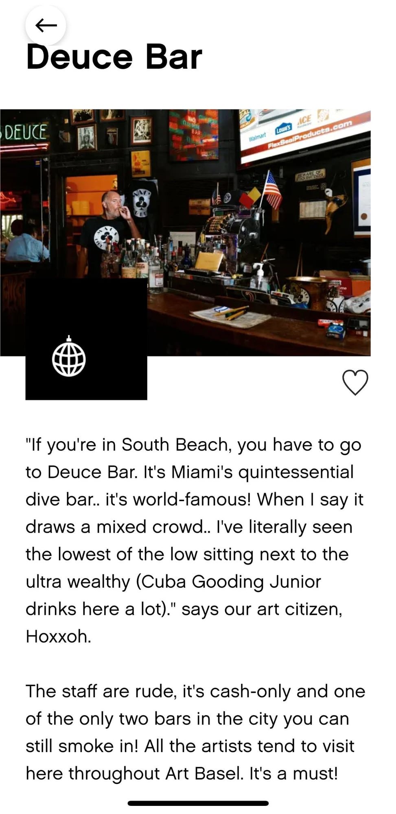
