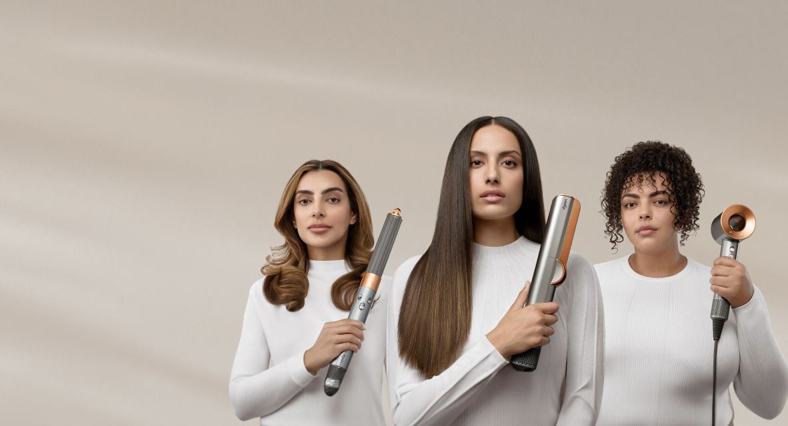
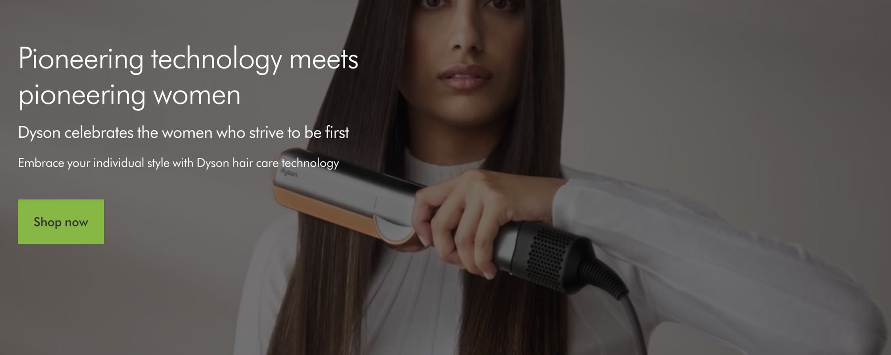
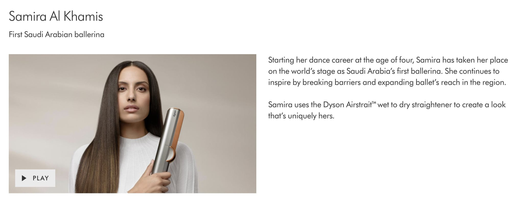
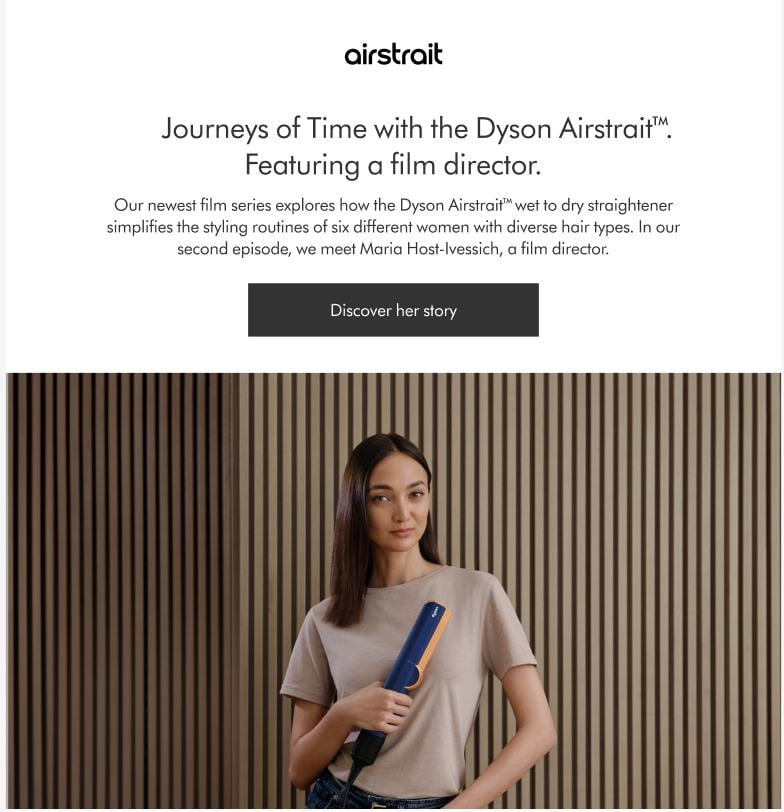
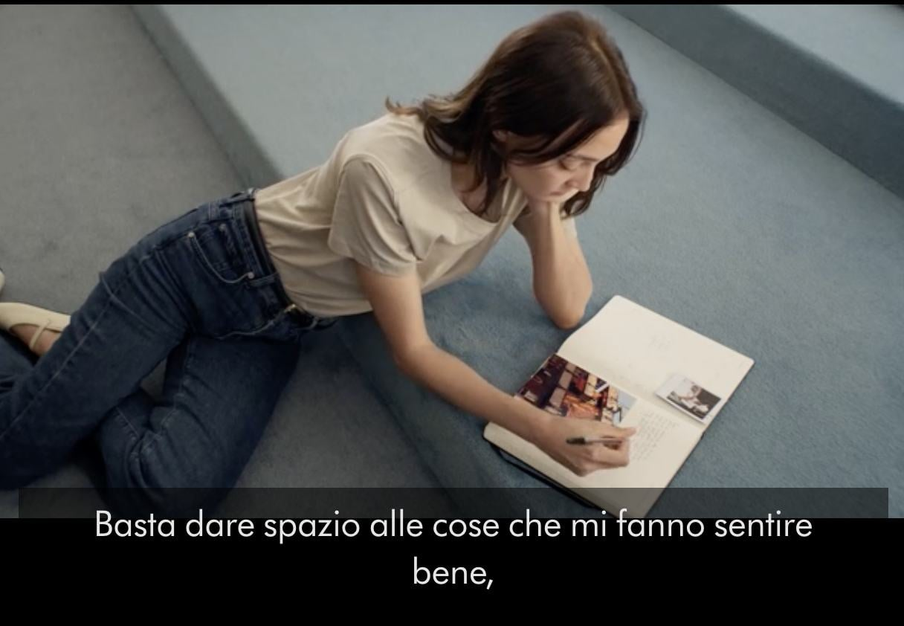
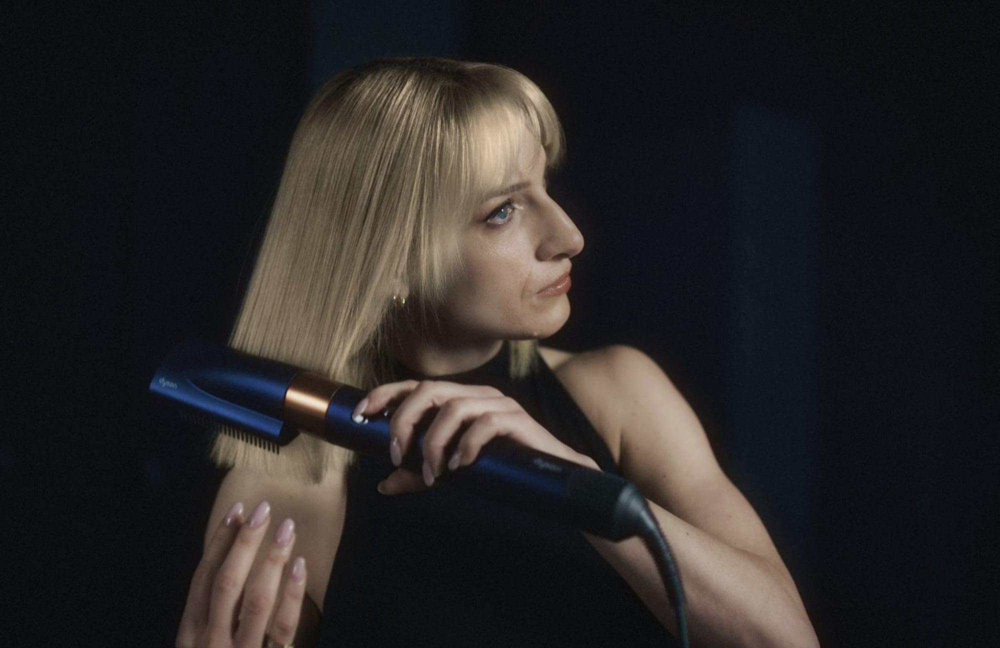
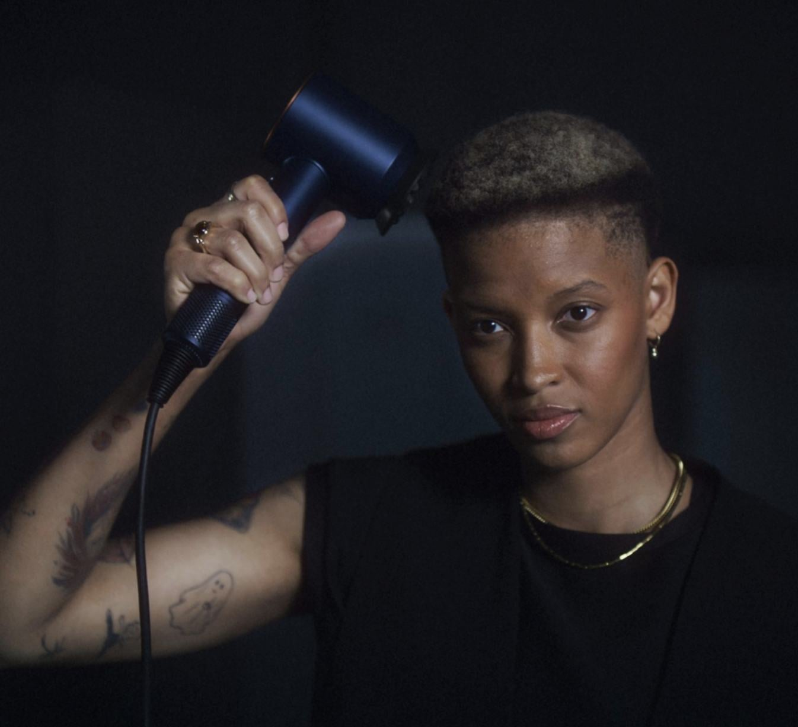
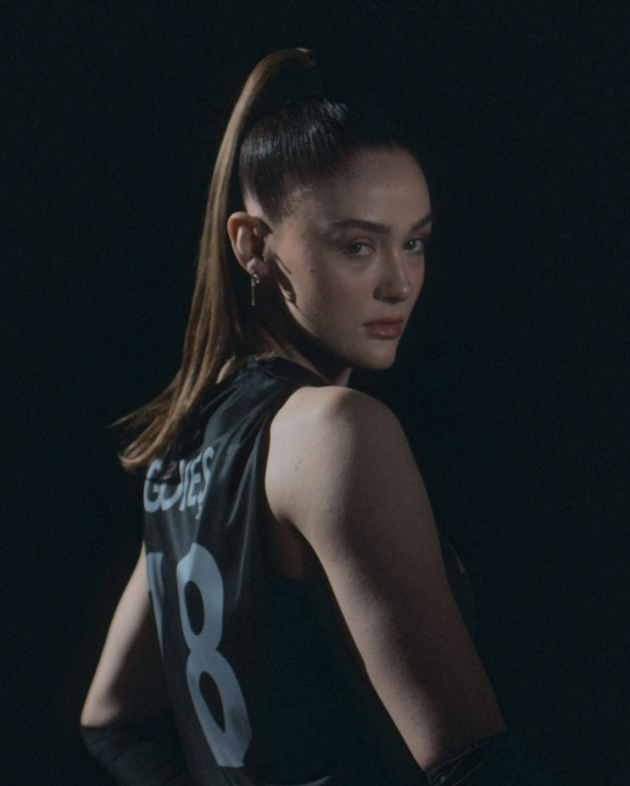
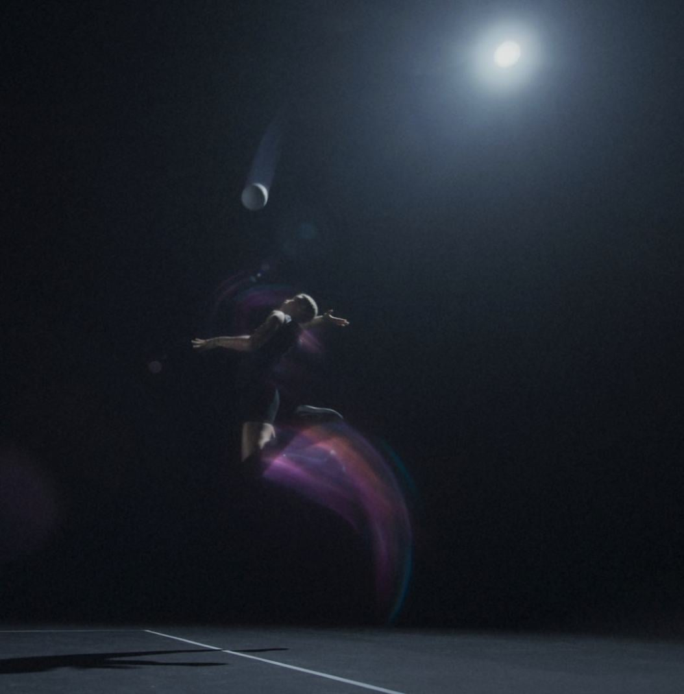

<figure class="project-clip project-clip--hero">
  <video autoplay loop muted playsinline preload="metadata" poster="/videos/dyson/dyson-journeys-of-time.jpg" aria-label="Dyson Airstrait campaign film featuring women styling their hair">
    <source src="/videos/dyson/dyson-journeys-of-time.mp4" type="video/mp4" />
  </video>
  <figcaption>MEA Women of Firsts – Campaign and web copywriting</figcaption>
</figure>

## MEA Women of Firsts

_Pioneering technology meets pioneering women._

In this hair care campaign for Dyson’s MEA market, we shone a light on women who strive to be the first in their fields. Accompanied by Dyson hair care machines, we were able to highlight these powerhouse women in a region that has traditionally not awarded the deserved recognition. I directed and personalised the digital and product page journey from conception to execution, highlighting each woman and her selected hair care machine.

[See the full campaign](https://www.dyson.ae/en-AE/products/hair-care/womens-of-firsts)

## Journeys of Time

_Your routine, simplified._

For Dyson’s Italian market launch of the Airstrait™, we asked six women how the Airstrait™ helps improve their beauty routines. The campaign spanned full-length videos on YouTube and our social channels, alongside a web and CRM journey for which I developed the strategy and wrote the copy.

[See the full campaign](https://www.dyson.nl/discover/jouw-apparaten/how-to/journeys-of-time)

<figure class="project-clip">
  <video autoplay loop muted playsinline preload="auto" aria-label="Dyson Airstrait styling a woman’s hair">
    <source src="/videos/dyson/journeys-full-film-edit.mp4" type="video/mp4" />
  </video>
  <figcaption>Journeys of Time – Digital journey</figcaption>
</figure>

## Dyson social media

Leading concepts, writing and approving Dyson copy across EMEA social channels.

## Sultans of the Air

For the campaign ‘Sultans of the Air’ starring Türkiye’s National Women’s Volleyball Team, we combined the powerful movement of these sportswomen with Dyson’s powerful machine engineering.

As with previous Dyson ‘personality’ campaigns, we matched a hair care machine to each player so she could express herself through her individual hairstyle. Alongside the out-of-home campaign, it ran as a CRM and digital journey, for which I developed the strategy and wrote the copy.

<section class="dyson-vis-nav-section" aria-labelledby="dyson-vis-nav-campaign">
  

    <h2 id="dyson-vis-nav-campaign">The Dyson 360 Vis Nav: faux out-of-home campaign</h2>
    
To celebrate the launch of the Vis Nav robot vacuum in the MEA region, we worked with agency AKQA to create a faux out-of-home campaign in pure Dubai style.

    
For Instagram, TikTok and LinkedIn, I wrote the copy for the social media supers, captions and CRM.

  

  <figure class="dyson-vis-nav-visual">
    <video autoplay loop muted playsinline preload="metadata" aria-label="The Dyson 360 Vis Nav faux out-of-home campaign">
      <source src="/videos/dyson/linkedin-7270394155296559105.mp4" type="video/mp4" />
    </video>
  </figure>
</section>

<section class="dyson-british-summer" aria-labelledby="british-summer-campaign">
  <h2 id="british-summer-campaign">Built for British Summer: OOH &amp; CRM</h2>
  
Imagine: it’s cold and wet. Your umbrella’s blown inside out. The next moment it’s hot and bright, but you’re not even sure if you should ditch your woolly jumper yet.

  
Think classic British summertime.

  
We wanted to spotlight the Dyson hot+cool purifier range in a way that our British audience would relate to, albeit (sometimes) reluctantly. This ran as an OOH campaign across the UK, as well as a CRM and digital effort. I wrote the copy for the CRM journey and worked alongside an art director and a fellow copywriter for the out-of-home taglines.

  <figure class="dyson-summer-hero"></figure>
  

    <figure class="dyson-crm-window"></figure>
    <figure class="dyson-crm-window"></figure>
  

</section>
