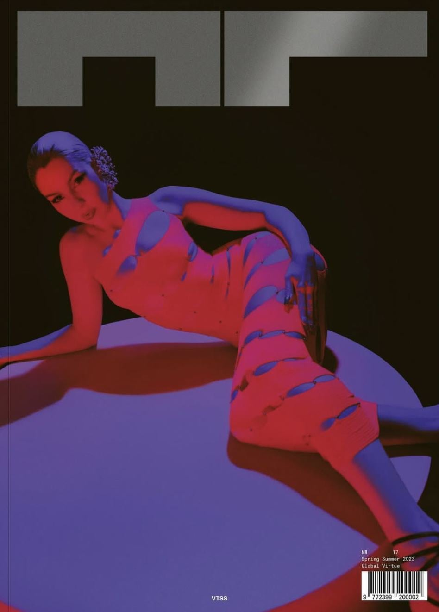
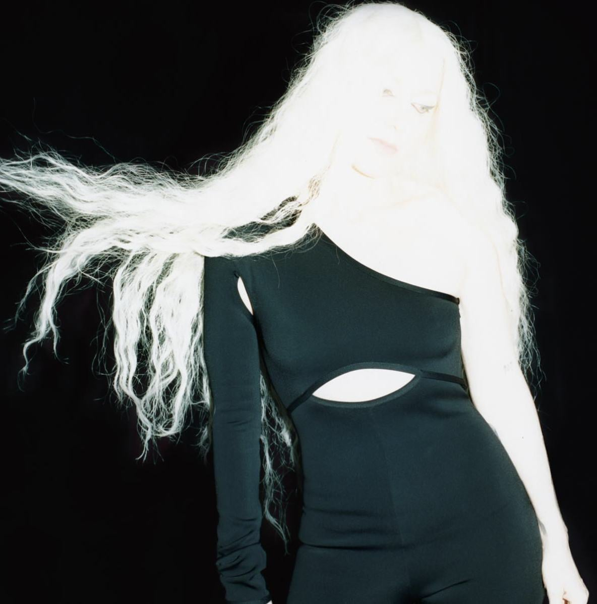
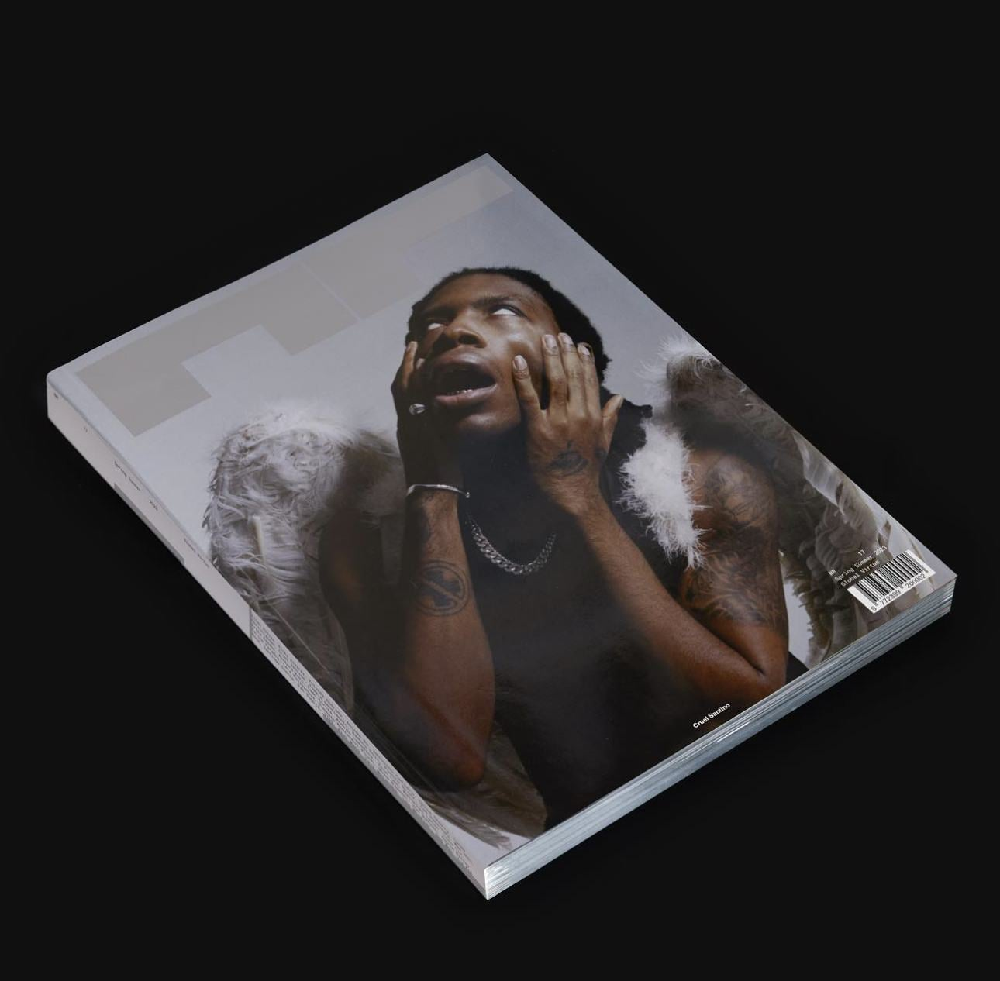
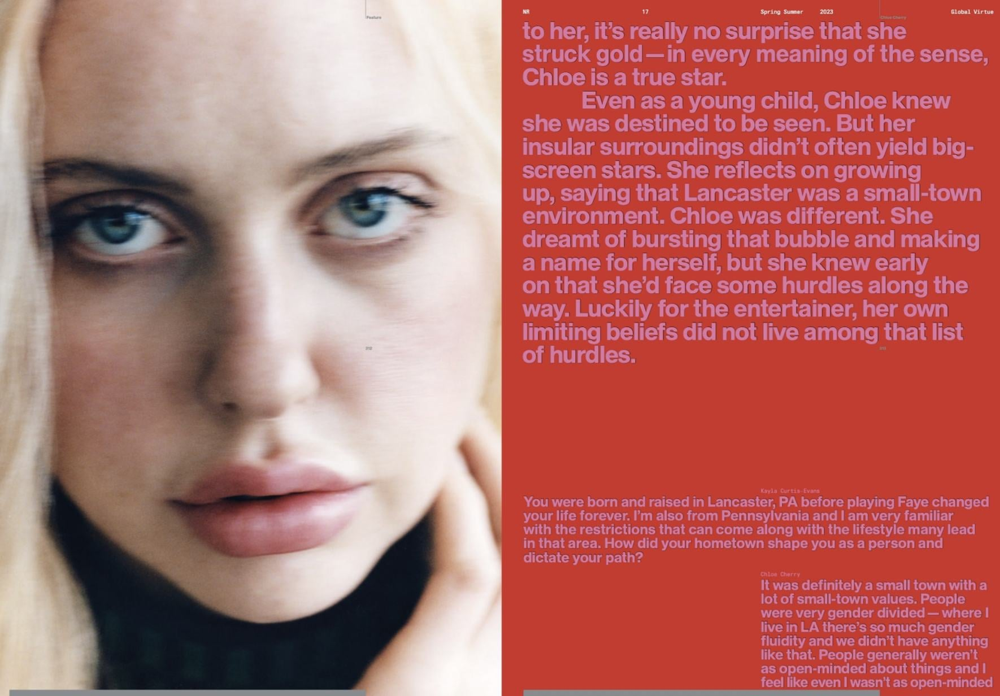
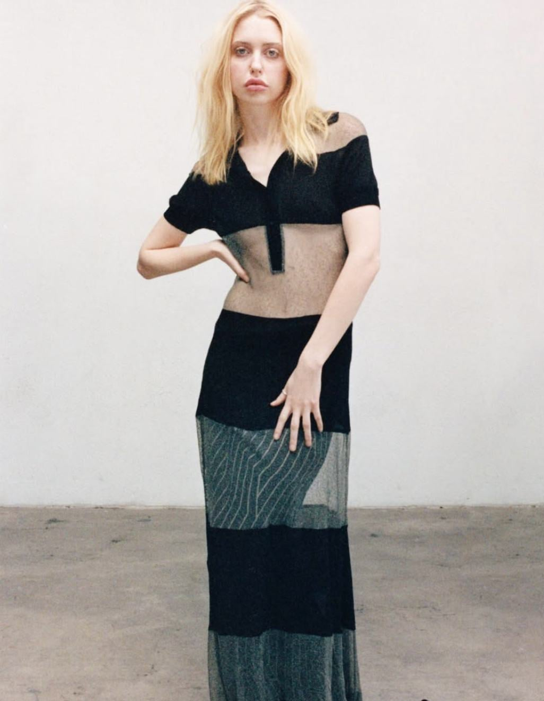

Founded in London in 2016, NR Magazine is an independent publication exploring culture at large, with a focus on art, design, film and music. For their 17th edition, I proofed and copy-edited all articles, featuring artists like VTSS, Ellen Alien, Santiago Sierra and Jon Rafman.

Additionally, I conducted an interview with Primavera Festival curator Joan Pons about the 2023 festival, discussing social progression within the festival and the connections of Barcelona, Madrid and the music festival industry.

[Read the full archive here.](https://nr.world/product/nr-17-the-global-virtue-issue/)
[Read my article with Joan Pons here.](https://nr.world/primavera-sound-festival-madrid-2023/)

