Otrium is a fashion e-commerce platform that believes that all clothing should be worn. As an editorial strategist, I worked intricately on editorial shoots and wrote engaging copy while ensuring the look & feel, brand identity and vision were met.

## B2B copy

With B2B copywriting, we celebrated the brand’s decision to join Otrium’s platform, while reiterating their partnership values – to make sure all clothing gets worn.

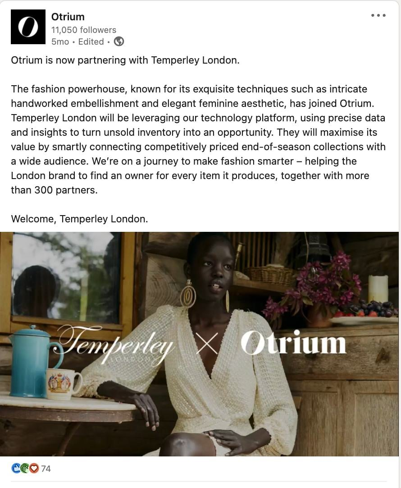
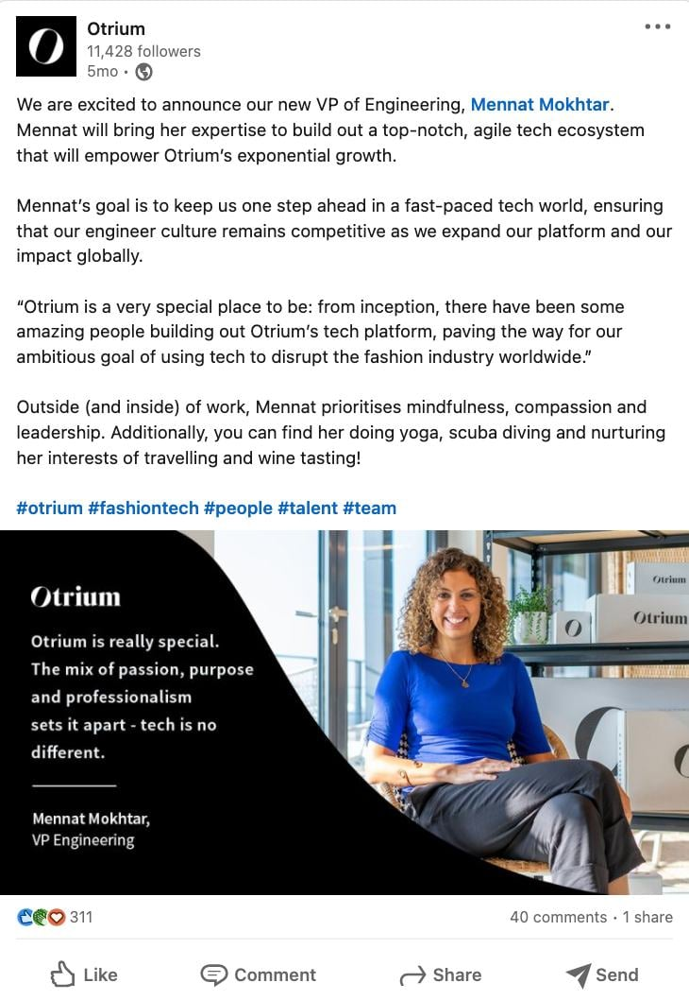
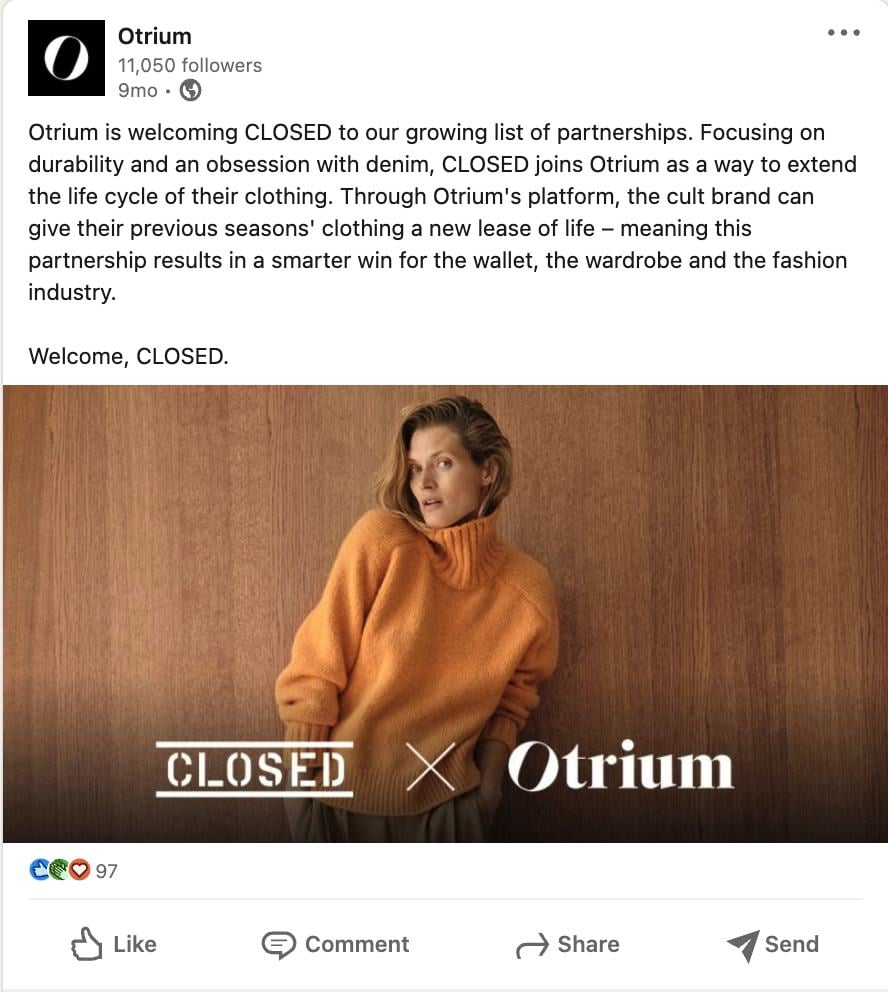
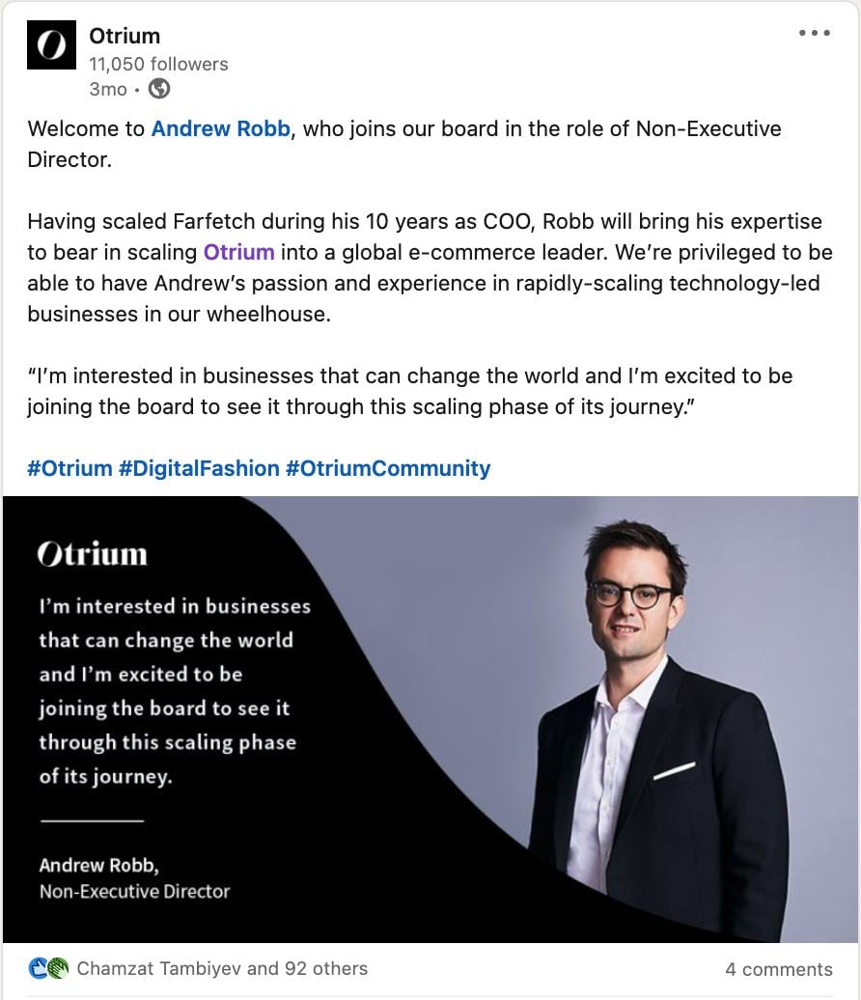

## B2C & social copy

Instagram was Otrium’s fastest-growing and most followed social platform. With these product shots, the copy is brief and casual, which I used to emulate a down-to-earth tone of voice.

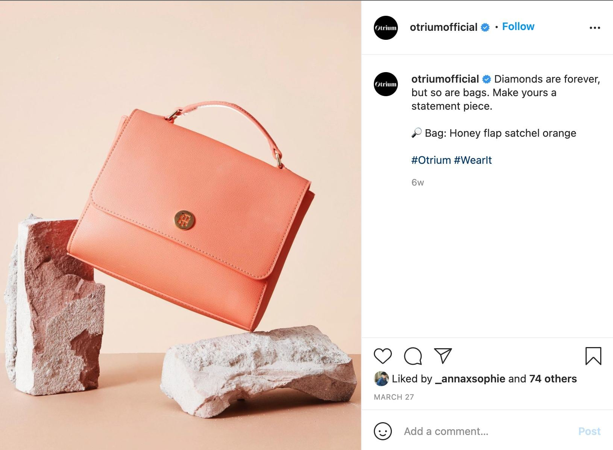
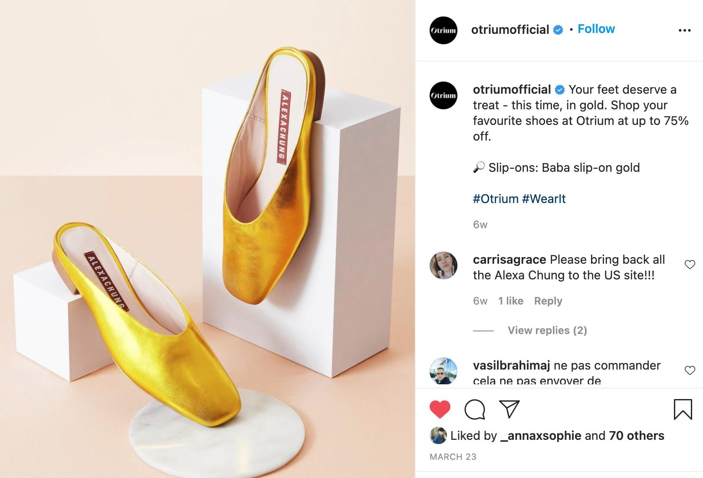

## B2C copy

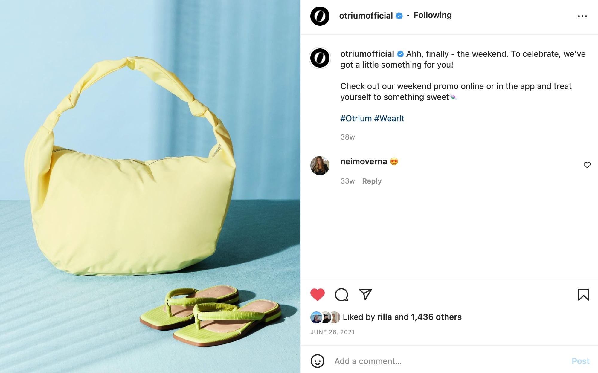
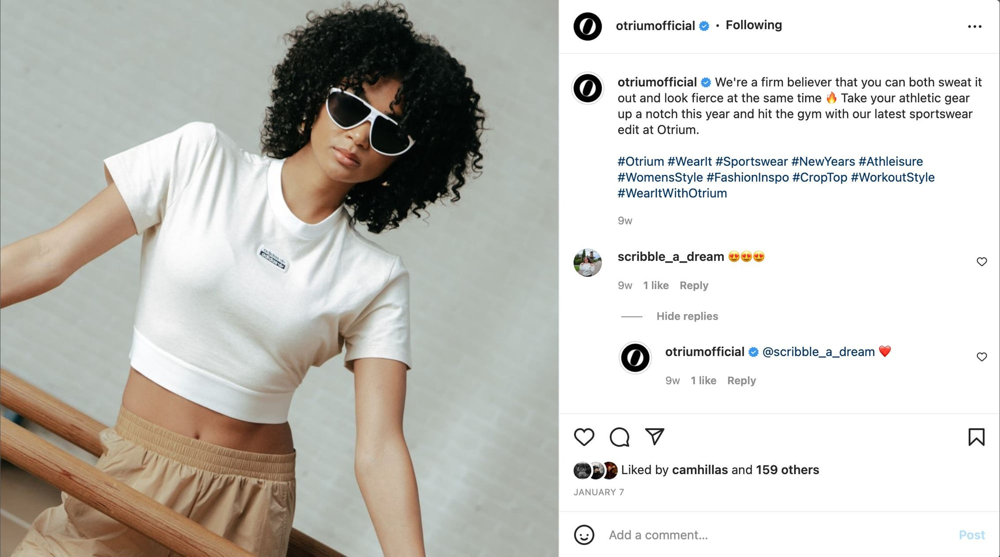
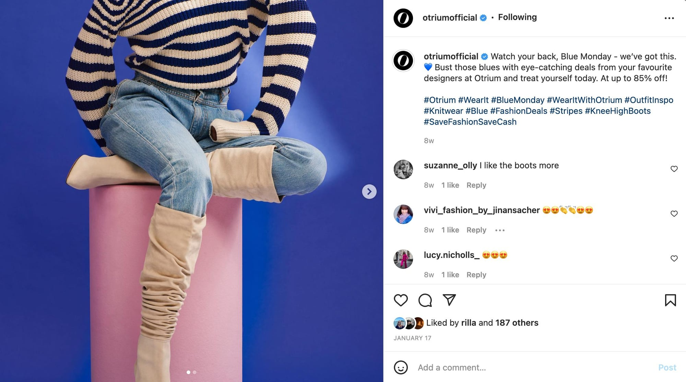

## Festive campaign FW21

_Do it twice as good_

For our 2021 Festive Campaign, we wanted to embrace the theme of opulence within everyday life after a difficult two years of staying indoors and distancing from loved ones. The result of this was to go ‘all out’ – think glittery extravagance in the otherwise mundane, everyday themes of the city.

With the usual theme of festivity and celebration fully embraced, we wanted to encourage our customers to think about living in the moment and enjoying the time they spend with others. After a long time of being isolated, it’s time to push the boat out with your nearest and dearest; dressed up and over the top to make up for lost time.

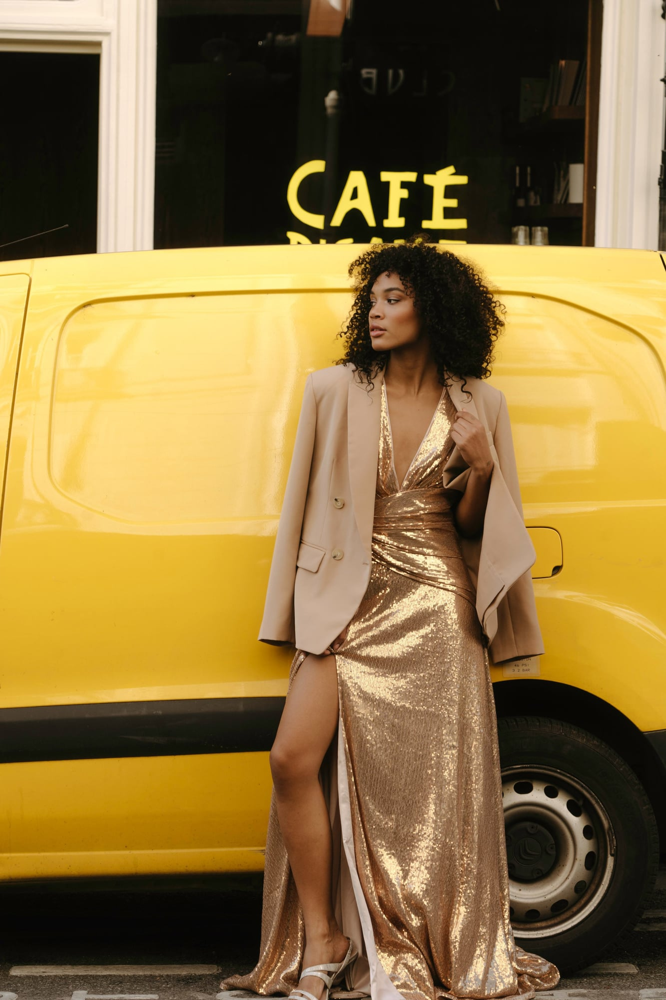
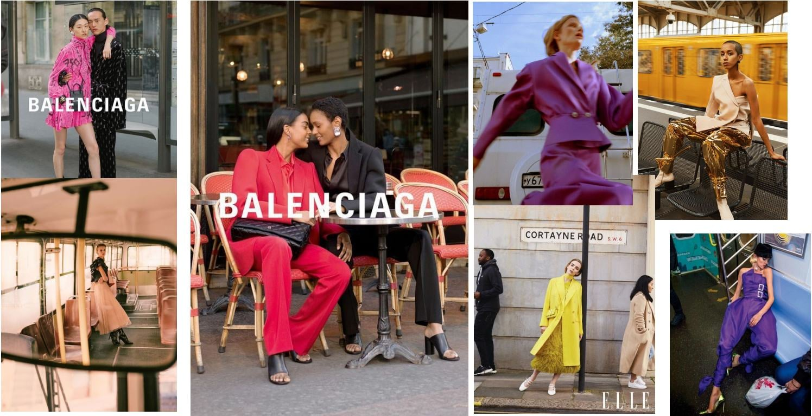

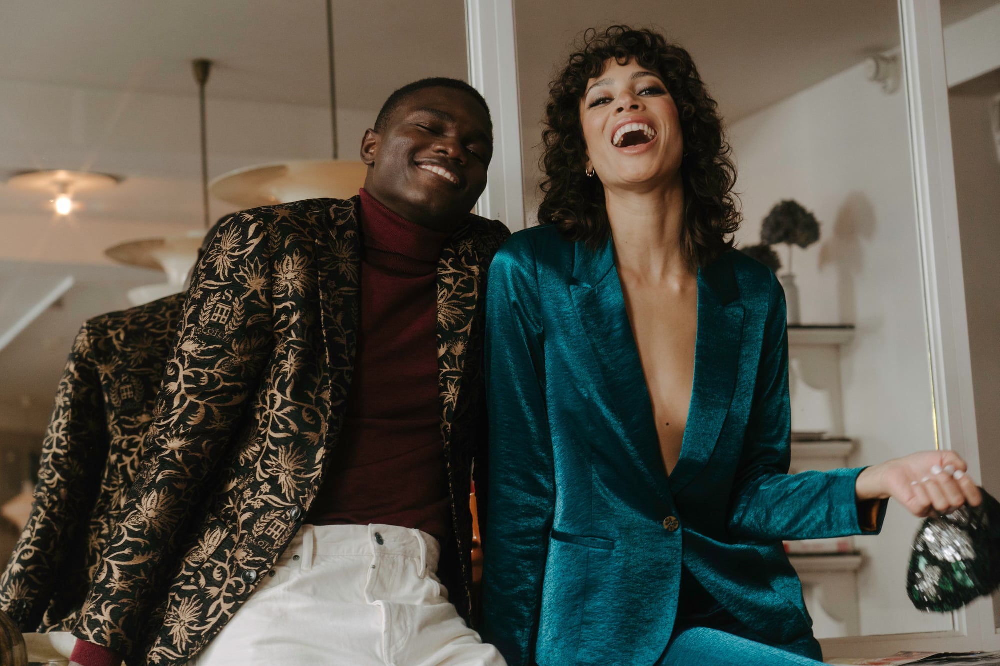

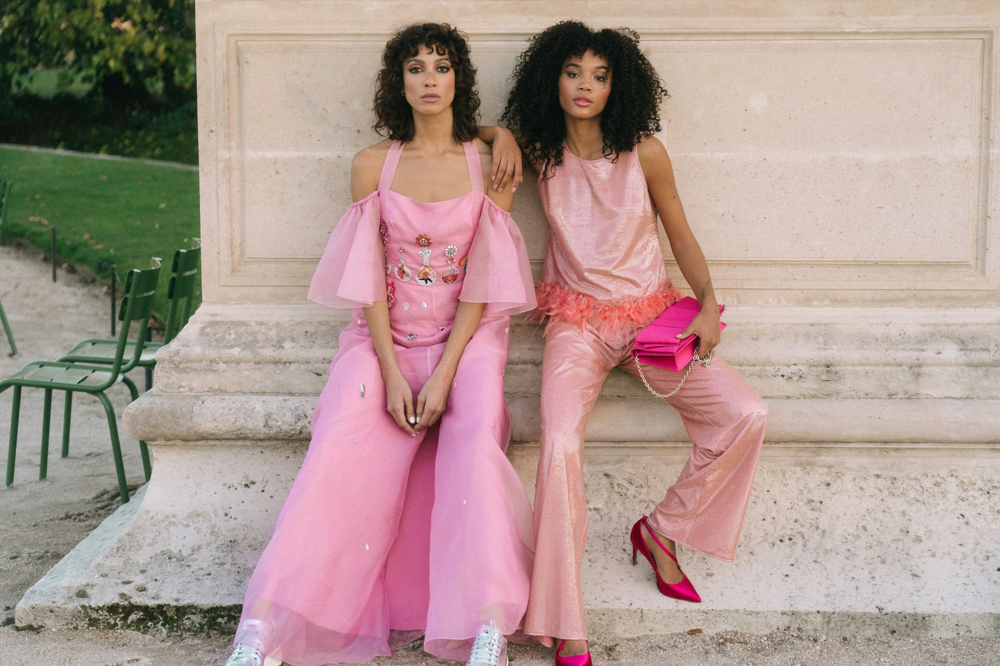

## E-commerce editorial

An e-commerce company by nature, we emphasised the importance of engaging and eye-catching clothing visuals on our platform. From brand-specific shop visuals to landing page headers, our creative team wanted to centre a vibrant and attractive visual identity on every web page.

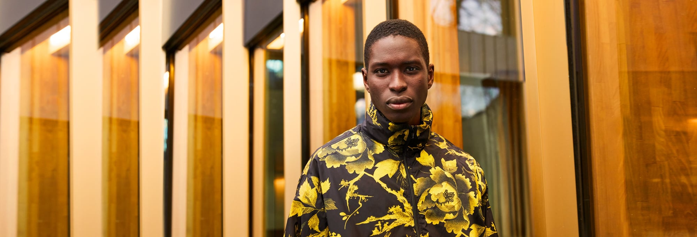

## Brand-specific: Alexander McQueen

For our brand-specific project for legendary designer Alexander McQueen, respecting the style of the clothes and the brand’s legacy came first and foremost.

We wanted the softness of the warm cedar wood to contrast against the rougher leather and acrylic pieces that the collection featured. Steely poses and eye contact from the models gave it the edge and attention we needed.

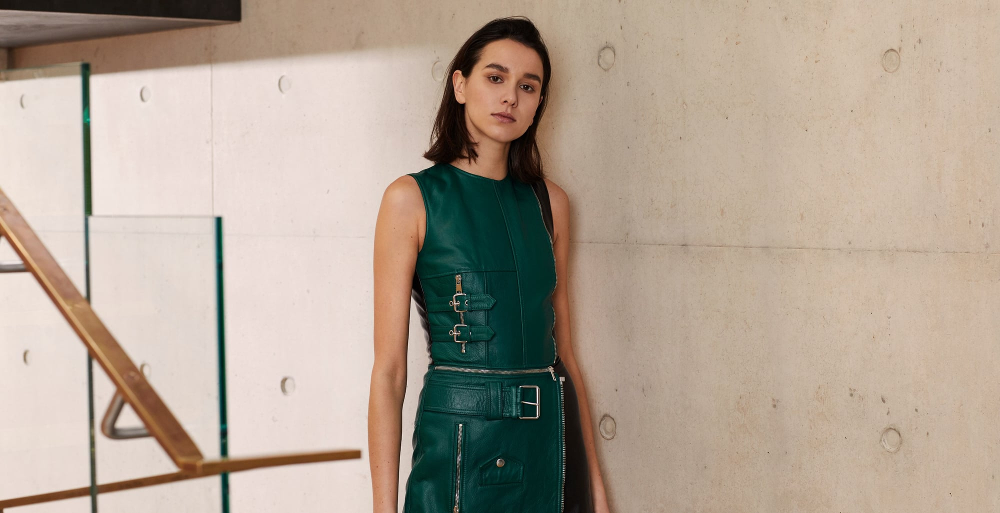

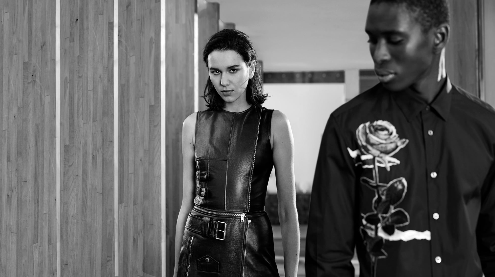
