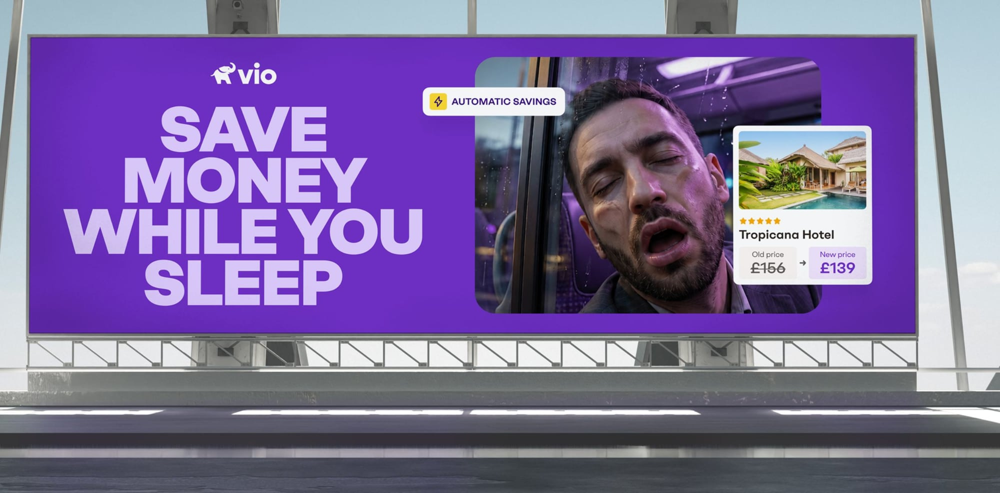
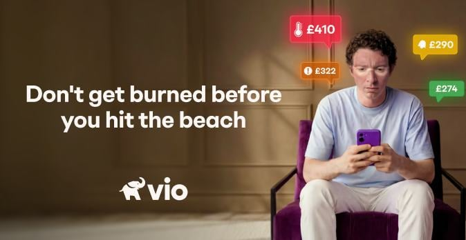
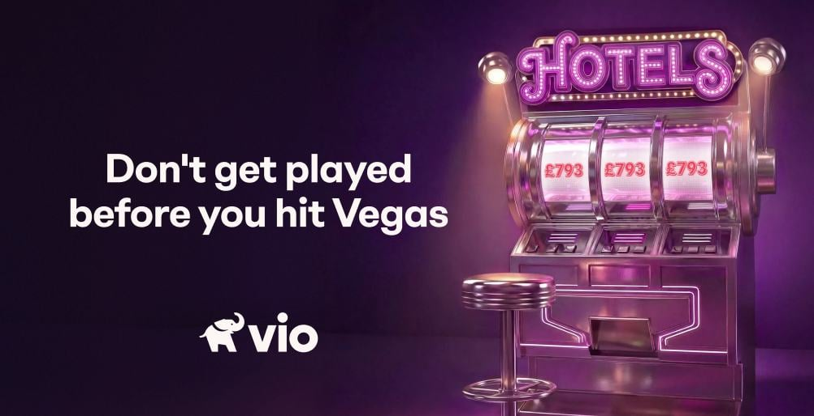

Vio.com is an online hotel booking platform that helps travellers make smarter booking decisions without the noise.

Working alongside esteemed design agencies Verve and Monks, I created Vio’s tone of voice and subsequent application across the entire Vio product.

Additionally, I worked with my design partner to bring full-scale campaigns to life, from creative conception to publish.

## Giving Vio its voice

_Book like an insider, not a tourist._

In an industry that’s noisy, urgent and competing for your attention, Vio set out to create a product that could redefine how travellers booked hotels.

Our tone needed to convey our industry expertise without the jargon or patronising travellers. Working alongside design agency Verve, we set out to create a voice that was measured, reassuring and curious throughout every touchpoint.

Born from Vio’s tagline: _Book like an insider, not a tourist_, it’s the belief that, with Vio, you can book smarter, not harder, in an industry full of distractions and gimmicks.

## Save money while you sleep

Created entirely in-house by me, my design partner and Head of Brand. The campaign was built around Automatic Savings: Vio quietly rebooks your hotel when the price drops, so the saving happens without you lifting a finger. We led with the most relatable proof of doing nothing, a traveller fast asleep, paired with a live hotel card showing the price drop. The campaign ran across both paid and organic social.

## Book like an insider, brought to life

We partnered with Monks on Vio’s UK paid storytelling campaign, which ran across Meta and YouTube. Having never advertised in the region, it meant we had a very small, yet crucial moment to grab our viewers’ attention and consideration.

The campaign storyline leant on familiar holiday tropes of being ripped-off, and how to avoid this by booking your hotel stay with Vio.

